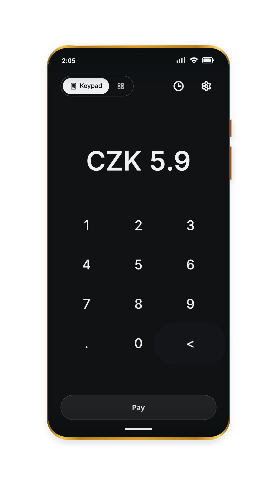
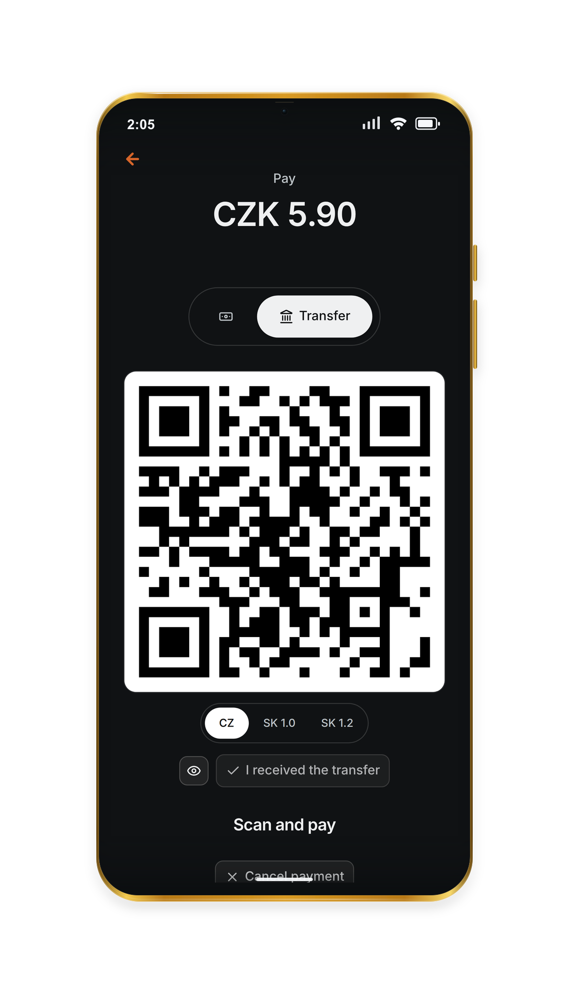
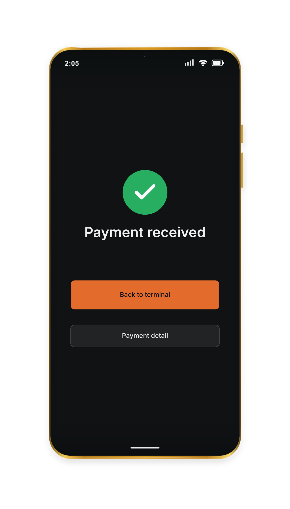

# Payky

Payky is a local-first point-of-sale application for managing terminal bill
flows, catalog items, bills, payments, account transactions, and background sync
jobs.

The app is built with React, TypeScript, Vite, TanStack Router, Tailwind CSS,
shadcn-style local UI components, Base UI primitives, Zod validation, and Evolu
for persistent application data.

<p>
  
  
  
</p>

## Requirements

- Bun

For native iOS development, install Xcode and the Xcode Command Line Tools.
Capacitor 8 targets iOS 15 and newer.

Install dependencies with exact versions:

```bash
bun install
```

Dependency versions are pinned through Bun. Keep `exact = true` in
`bunfig.toml`.

Install the locked Codex skills from `skills-lock.json`:

```bash
bunx skills experimental_install
```

## Workspaces

`apps/web-app` owns the web app, API and documentation tools.
`apps/landing` owns the independently deployed marketing site at `/landing`
(see [landing deployment](docs/landing-deployment.md)).
`packages/web-shared` owns the browser navigation contract and shared hooks.
`apps/native-shell` wraps its `dist-native` build in Capacitor; `apps/cli` runs
local commands. All use the single domain implementation in `packages/core`.
`apps/native-app` is the separate Expo + React Native + Tamagui application,
currently limited to a native preview and shared-core smoke check.
Core uses explicit package subpaths such as
`@payky/core/modules/payment/payment-actions`; `@/` stays local to the web app.

Keep local `.env` files at the repository root (use
`apps/web-app/.env.example` as the template). Vite loads that directory for both
root and direct workspace commands. Run the CLI from the root, or use Bun's
`--env-file` option when launching it elsewhere.

`bun run build` emits core JavaScript for production API loading before building
the web app. `bun run check:api` checks every API module with Node against those
emitted exports. Browser and Bun consumers resolve core source instead.
The shared release version stays in the root `package.json`.

## Development

Start the Vite dev server:

```bash
bun run dev
```

Build the app:

```bash
bun run build
```

Preview a production build:

```bash
bun run preview
```

## Expo native application

Use Node 22.13+ on a supported release line for Expo tooling, and Bun for
dependencies and scripts. Install Android Studio and an Android SDK/emulator
for Android; iOS requires macOS and Xcode. The existing Vite and Capacitor
commands remain available independently.

From the repository root:

```bash
bun install
bun run native:android  # build/install a development client on Android
bun run native:ios     # build/install a development client on iOS (macOS)
bun run dev:native     # start Metro for an already installed development client
```

`native:android` and `native:ios` generate their native projects locally; they
are ignored by Git. The preview uses `me.payky.nativepreview` and the
`payky-native-preview` scheme so it can coexist with the Capacitor app.
Use a development client rather than relying on Expo Go availability for SDK
58. The Expo app has no environment variables or connected services yet.

The root native commands build `packages/core` first. Metro uses its existing
public exports; the native app never imports web application source. Keep
`bun run dev` running in a second terminal when developing the Vite web app
alongside Expo. For an offline Metro session use `bun run dev:native --offline`.

```bash
bun run check:native   # native TypeScript; also included in bun run check
bun run check:lint     # shared Biome configuration includes native source
bun run build:native   # export Android and iOS bundles into apps/native-app/dist
```

The preview loads bundled Inter fonts, follows the system light/dark theme,
and calls the existing core cash-rounding function with an asserted result.
`entry.ts` installs secure random values and UUIDs from Expo Crypto before
loading Expo Router: Evolu needs randomness while importing the shared core.
After adding or upgrading native modules, rebuild the development client with
`bun run native:android` or `bun run native:ios`; restarting Metro is insufficient.
On a device, check that `123.45` becomes `123.00` and that **Run shared logic
again** increments the passed-check count. Change the system theme to verify
both palettes. This verifies the shared helper in the native renderer; exporting
a bundle alone does not verify device execution.

No accounts, SQLite persistence, wallet, payment terminal or background jobs
are wired up or mocked. Those remain subsequent runtime-spike tasks in
[the migration plan](MIGRATION_PLAN.md).

## Native Targets

Capacitor is available as the Android native target:

```bash
bun run cap:android:sync
bun run cap:android:dev
bun run cap:android:build
bun run cap:ios:sync
bun run cap:ios:run
bun run cap:ios:open
```

Capacitor builds use the native HTTP bridge through `CapacitorHttp` so mobile
requests are not limited by browser CORS behavior.

For Capacitor Android live reload, run:

```bash
bun run cap:android:dev
```

The script starts the HTTP Vite dev server, waits for
`http://127.0.0.1:5173`, forwards the port through Capacitor's Android live
reload flow, and launches the native Android app. The HTTP server is used only
for this debug flow so Android WebView does not reject Vite's self-signed HTTPS
certificate.

For Capacitor iOS simulator development, run:

```bash
bun run cap:ios:run
```

For Xcode-driven iOS development, run:

```bash
bun run cap:ios:sync
bun run cap:ios:open
```

Configure the signing team, bundle identifier, provisioning profile, display
name, icons, launch screen, and deployment target in Xcode. The default bundle
identifier is `me.payky`.

For iOS live reload on a physical iPhone, start Vite on the local network in one
terminal:

```bash
PAYKY_DISABLE_BASIC_SSL=1 bun run dev -- --host 0.0.0.0 --strictPort
```

Then point Capacitor at the Mac LAN URL from another terminal:

```bash
PAYKY_CAPACITOR_SERVER_URL=http://<mac-lan-ip>:5173 bun run cap run ios
```

The iPhone and Mac must be on the same network. iOS does not have an `adb
reverse` equivalent, so a physical device cannot use `localhost` to reach the
Mac dev server.

The Android release build signs with `payky-release.keystore`. Set these
environment variables before running `bun run cap:android:build`:

```bash
PAYKY_ANDROID_KEYSTORE_PASSWORD=...
PAYKY_ANDROID_KEY_ALIAS=...
PAYKY_ANDROID_KEY_PASSWORD=...
```

## Checks

Run the full validation suite:

```bash
bun run check
```

Run checks individually:

```bash
bun run check:lint
bun run check:ts
bun run check:decisions
bun run check:tests
bun run check:coverage
```

`check:decisions` verifies that every business decision in `docs/decisions`
names the tests that hold it. End-to-end tests are not part of `check`; run
them with `bun run test:e2e`.

Format files with Biome:

```bash
bun run format
```

Run Vitest in watch mode:

```bash
bun run test:watch
```

## Project Layout

- `apps/web-app/src/main.tsx` is the browser entry point.
- `apps/web-app/src/App.tsx` wires top-level providers and the TanStack Router provider.
- `apps/web-app/src/routes` contains file-based route definitions.
- `apps/web-app/src/components/ui` contains reusable shadcn-style UI primitives built on
  Base UI.
- `apps/web-app/src/i18n` contains the English, Czech and Slovak translations, one
  `<lang>/<group>.ts` file per group of keys.
- `packages/core/src/evolu` creates the Evolu client and composes the application schema.
- `packages/core/src/modules` contains domain modules for accounts, transactions,
  catalog items, bills, payments, tables, reconciliation claims, settings,
  devices, and Fio integration.
- `apps/cli/src` contains CLI commands for local data management and background jobs.
- `apps/native-shell` owns the Capacitor configuration and Android/iOS projects.
- `bin` contains repository checks and release scripts.

## UI Components

Local UI components live in `apps/web-app/src/components/ui` and should be imported directly
from their owning module:

```tsx
import { Button } from "@/components/ui/button.tsx"
```

When adding shadcn components, use Bun:

```bash
cd apps/web-app
bunx shadcn@latest add button
```

Keep generic reusable UI in `apps/web-app/src/components/ui`; feature and domain logic should
live outside that directory.

## Data Model

Persistent application data is stored through Evolu. Register new tables and
indexes in `packages/core/src/evolu/schema.ts`, and keep domain code in the owning module
under `packages/core/src/modules`.

Domain modules generally use this structure:

- `*-types.ts` for branded ids, enums, unions, and exported domain types.
- Module root files, such as `payment.ts`, for Evolu table schemas and row
  exports.
- `*-actions.ts` for Evolu mutations and command-style operations.
- `*-queries.ts` for reusable Evolu queries and read models.
- `*-utils.ts` for pure helpers.
- `*.test.ts` beside the module it covers.

## Account Seed and Key Derivation

Each device account has a 128-bit master secret `S` (the `MasterKey`). For a
path `P`, derive a child key and independent 32-byte entropy:

```text
R = BIP32.MasterKey(S)
K = BIP32.Derive(R, P)
E = HMAC-SHA512(
  key = "bip-entropy-from-k",
  message = K.privateKey
)[0:32]
```

Payky paths follow [BIP-85](https://github.com/bitcoin/bips/blob/master/bip-0085.mediawiki),
most with the BIP-39 application: `m/83696968'/39'/{language}'/{words}'/{index}'`,
language `0'` = English. The word count encodes how much of `E` the consumer
uses (24 words = 32 bytes, 12 words = 16 bytes). The paths must never change
after accounts exist.

| Consumer | Path `P` | Result |
| --- | --- | --- |
| Evolu master owner | `m/83696968'/39'/0'/24'/1'` | `E` as the 32-byte Evolu owner secret |
| Default Spark wallet | `m/83696968'/39'/0'/12'/0'` | `E[0:16]` as the 16-byte Spark wallet secret |
| Cashu wallet seed | `m/83696968'/128169'/64'/0'` | BIP-85 HEX: all 64 bytes of `E` as the NUT-13 seed, no mnemonic in between |

The Spark wallet secret is stored as hex and used as BIP-39 entropy: wallet
initialization and the settings UI encode it as a 12-word mnemonic (never the
raw secret), so the wallet can also be restored in any BIP-39-compatible Spark
client. The Cashu seed uses BIP-85's HEX application
(`m/83696968'/128169'/{bytes}'/{index}'`), under which Linky derives
nothing, so Payky's Cashu wallet never collides with Linky's
(`docs/decisions/cashu/0012`); `key-derivation.test.ts` pins it.

`S` itself is backed up as a single [SLIP-39](https://github.com/satoshilabs/slips/blob/master/slip-0039.md)
20-word recovery mnemonic (`packages/core/src/modules/shared/key-derivation.ts`, via
the `slip39-ts` library), encoded as one group with a 1-of-1 threshold — there
is currently no multi-share Shamir splitting, so the phrase is the sole backup
of `S` and must be treated with the same care as a BIP-39 seed phrase. SLIP-39
mnemonics use their own wordlist and checksum and are not interchangeable with
BIP-39 mnemonics. The mnemonic's identifier (SLIP-39's 15-bit metadata field)
is derived deterministically from `S` via HMAC-SHA512 rather than randomized,
so encoding the same `S` always produces the same recovery phrase. 256-bit
master keys and their 33-word recovery mnemonics are not supported.

## CLI

The CLI reads `.env` files automatically. Environment variables are validated at
startup with `@t3-oss/env-core` and Zod.

```bash
PAYKY_SQLITE_PATH=./.data/payky.db bun run cli payments list
bun --env-file=.env.cli apps/cli/src/cli.ts accounts list
```

Supported variables:

- `PAYKY_SQLITE_PATH`: SQLite database file path. Defaults to `.data/payky.db` at the repository root.
  An explicit relative path is resolved against the caller's working directory.
- `PAYKY_AI_BASE_URL`: OpenAI-compatible endpoint. Defaults to Payky's AI
  proxy, `https://payky.me/api/ai/v1`, which holds the provider and its key
  and takes the account's owner id as its key (`docs/decisions/ai/0001`).
  Point it at a local Ollama, `http://localhost:11434/v1`, to develop
  without it.
- `PAYKY_AI_MODEL`: model name for an endpoint other than the proxy, which
  picks its own; it must support tool calling.

`bun run cli` replaces `bun bin/cli.ts`. The launcher preserves the caller's
working directory. `payky ai` is a prototype assistant: it reads
the local data, and the docs and source code git tracks. It never writes.

```bash
bun run cli ai "Which bills are still open?"
PAYKY_AI_BASE_URL=http://localhost:11434/v1 PAYKY_AI_MODEL=qwen3 \
  bun run cli ai "How does bill coverage work?"
```

## Internationalization

All user-facing React text goes through `t(key)`. Add each key to the group file
its namespace belongs to — `apps/web-app/src/i18n/en/<group>.ts`, then the same file under
`cs/` and `sk/` — and use stable, feature-scoped names such as `bill.save`,
`settings.items.title`, or `activity.empty`. `bun run check:ts` fails while a
key is missing from any language.
